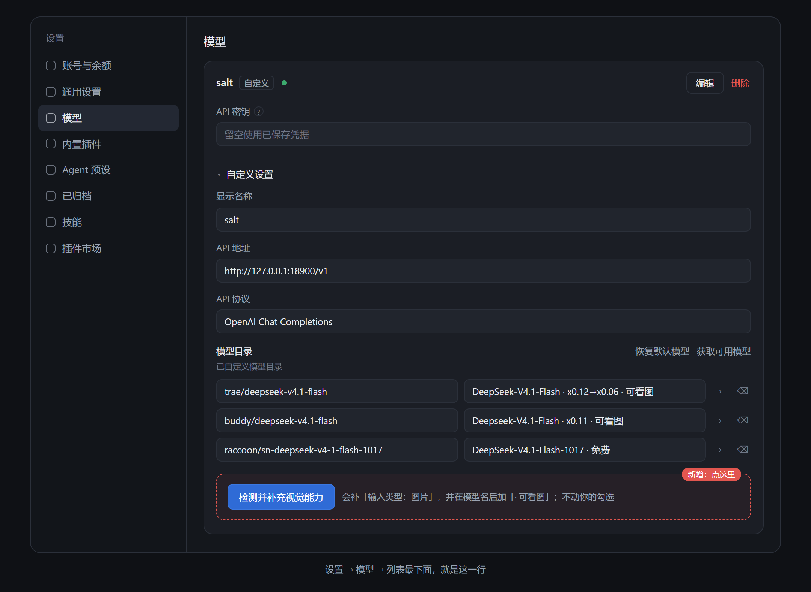
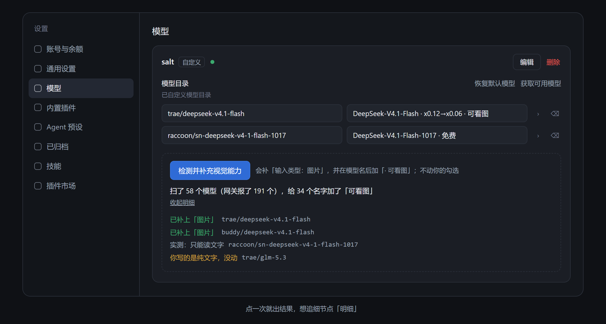

# 让 DSH 认得哪些模型能看图

DSH 在点「获取可用模型」的时候，只记下了模型的名字和长度，**漏记了"这个模型能不能看图"**。
所以你把图片贴给它，它会说「这个模型不支持图片输入」，图根本没送出去。

这个插件就是替 DSH 把这一项补上：**能看图的模型，自动帮你勾上「输入类型：图片」**，以后每次拉模型都自动补，不用再手动点。

> 适合：你用第三方网关 / 中转站 / 自建服务（任何 OpenAI 兼容的地址），并且想让模型能看图。
> 不适合：你直接用官方 API，而它本来就不吃图片——插件不会让只读文字的模型学会看图。



*按钮就在「模型」页模型列表的最下面（图中红框处）。*



*点一次就出结果；想追细节点「明细」。*

---

## 你可能正遇到这些

- 贴了一张图，DSH 回「模型不支持图片输入」，或者图被当没看见
- 网关的说明里明明写着某个模型支持图片，DSH 里它却没有「图片」这个选项
- 你手动勾过一次「图片」，下次再点「获取可用模型」，勾又被清掉了——因为拉清单的时候没带这条信息

一句话解释原因：DSH 拉模型清单时只看名字和长度，不看"能不能看图"，于是默认当成只能读文字。

---

## 它做什么（两件小事，都在同一步里完成）

1. 读你网关自己公布的能力，把**「输入类型」里的「图片」**替你勾上；
2. 给能看图的模型**在名字后面加一个「· 可看图」**，这样在对话框里切模型时一眼就能认出来。

> 标注长这样：`DeepSeek-V4.1-Flash · 可看图`
> 之所以写进名字里，而不是画个小标签：切换器的标签位置被 DSH 自带的 1017 标注占着（同一个位置只能有一个），写进名字是唯一在所有地方都看得见的做法——切模型、设置页、会话头部都生效。
> 不想要这个标注：配置里把 `badgeSuffix` 设成 `''`（见文末）。

- 网关说支持图片 → 勾上
- 网关说只能读文字 → 不动
- 网关什么都没说 → 不动（不猜，猜错了你要等报错才发现）
- 你手动勾过或取消过 → 不动（你的选择优先）

> 默认只"补空缺"。想让它连你手写错的也一起纠正，把 `mode` 改成 `sync`（见文末配置）。

---

## 怎么用：正常情况下不用管，想检查就点一下

**装好就在后台干活**，你什么都不用点。想立刻把已经配好的模型检查一遍：

> **设置 → 模型** → 滚到模型列表最下面 → 点「检测并补充视觉能力」

点完就地出结果（一句话 + 「展开明细」），不用换页。

点了之后它会做两件事：

1. 先看网关自己怎么写的——写了就照它写（这一步很便宜）；
2. 网关**没写**的模型，它就**真的发一张纯色图过去问「这是什么颜色」**，问两轮、两个不同颜色，答对了才算能看图。

几个你会关心的事：

| 你可能会问 | 答案 |
|---|---|
| 会动我的勾选吗？ | 不会。它只补「输入类型：图片」，模型还是你选的这些 |
| 会花很多额度吗？ | 只测网关没写能力的模型，每个模型最多两次很小的请求；单次最多 40 个（可调），超出会显示「跳过 N 个」 |
| 会重复测吗？ | 不会。测过的结论会记住：能看图的记 7 天，不能的记 1 天 |
| 为什么有的模型「没结论」？ | 模型答非所问（比如回一整段话不提颜色）。这种**不会**被当成"只能读文字"，宁可不写也不写错——你自己去「输入类型」里勾一下就行 |

---

## 支持哪些网关

只要能被 DSH 当供应商用，这个插件基本都能处理，因为它不假设路径和字段名：

| 你的东西 | 怎么找模型清单 | 能不能一键探测 |
|---|---|---|
| 官方/中转站（OpenAI 兼容，`/v1/chat/completions`） | `/models`，找不到就试 `/v1/models`、`/model/info` | 能 |
| 自建 vLLM / LM Studio / one-api / new-api | 同上（`baseURL` 写不写 `/v1` 都行） | 能 |
| Anthropic 协议（`/v1/messages`） | `/v1/models?limit=1000` | 能 |
| Ollama | `/api/tags`（按模型名匹配） | 能（但要它自己回答了才算） |
| Responses 协议（`/responses`） | `/models` | 只看清单，不探测（它的图片格式不一样，乱猜会误判） |

判断能力时它认这些写法：`input`、`input_modalities`、`inputModalities`、`architecture.input_modalities`、`modalities.input`，以及布尔字段 `vision`、`supports_vision`、`image_input`、`capabilities.vision`。

---

## 装好之后会怎样

1. **第一次启动**：扫一遍你已经配好的模型，该勾的勾上。实测一台 58 个模型的网关，34 个被正确勾上，其余 24 个原样不动（它们要么只能读文字，要么网关没说明）。
2. **以后每次点「获取可用模型」**：5 秒内自动补齐新勾进来的模型，不用再手动点。
3. **每 5 分钟**还会对一次账，上游换了能力也能跟上。

除了「输入类型」这一项，**别的什么都不改**：配置文件里的注释、字段顺序、你手写的其他设置，一个字符都不动。

---

## 怎么装

### 从插件市场装（推荐）

设置 → 插件 → 搜索 `dsh-model-vision` → 安装 → **重启 DSH**。

### 从 GitHub 装（还没上架市场时）

```bash
dsh plugin --profile web add github:charovo0059/dsh-model-vision
```

这条命令会同时把插件登记进 `dsh.profile.bundles`，不用手改。然后**重启 DSH**。

### 从本地目录装（自己改代码时）

```bash
dsh plugin --profile web add link:<插件目录的绝对路径>
```

装完自检（会告诉你哪一步缺了）：

```bash
node tools/check.mjs --profile web
```

### 想先看看它打算怎么改，再决定装不装

```bash
node tools/preview.mjs --profile web
```

只读：读你的配置、问一次网关、把"会改哪几行"打出来，**一个字节都不写**，DSH 开着也能安全跑。

---

## 怎么确认它在工作

**最直观的**：设置 → 模型 → 找一个你确定能看图的模型 → 点开「输入类型」→ 「图片」已经勾上了。

**看记账本**：每次干完活它都会写一份记录，位置在 `~/.dsh/model-vision.status.json`。**只看 `message` 这一行就够了**，它是给你写的人话：

```
"message": "扫了 58 个模型（网关报了 191 个），补了 34 个的「输入类型：图片」"
```

一共只会出现五种话：

| `message` 说什么 | 意思 |
|---|---|
| 补了 N 个的「输入类型：图片」 | 正常干活，补了 N 个 |
| 没有要改的 | 正常，你配的模型都已经对上了 |
| 本来可以补 N 个……但只看不写模式（dryRun）开着 | 你把 dryRun 打开了，它只看不动 |
| 出错了：…… | 后面跟的就是原因 |
| 没有可检查的模型 | 还没配供应商，或者没点过「获取可用模型」 |

想看细节再看这几个字段：

| 字段 | 大白话 |
|---|---|
| `wrote` | 这次有没有真的改东西 |
| `routes[].changes` | 改了哪几个模型 |
| `routes[].listed` | 网关报了几个模型（0 = 网关没连上或没公布） |
| `routes[].credential` | 用的哪份 key（`file` = 本地凭据文件，`absent` = 没找到） |
| `error` | 出了什么错（没有就是 `null`） |

正常的一次长这样（`message` 之外的部分是给程序看的，看不懂可以跳过）：

```json
{
  "message": "扫了 58 个模型（网关报了 191 个），补了 1 个的「输入类型：图片」",
  "wrote": true,
  "routes": [{
    "route": "salt",
    "models": 58,
    "listed": 191,
    "credential": "file",
    "changes": [{ "id": "trae/deepseek-v4.1-flash", "to": ["text", "image"] }],
    "error": null
  }]
}
```

`models` 是你配了几个模型，`listed` 是网关报了几个模型，`changes` 是这次补了哪几个。三者都正常、`error` 是 `null`，就说明它在正常工作。

---

## 会不会弄坏我的配置

- 只写「输入类型」这一个字段，写完立刻停手
- 没有要改的就**一个字节都不落盘**
- 写之前逐行比对，注释和别的字段原样保留
- 万一写坏了：改之前先备份 `~/.dsh/profiles/web/cordis.patch.yml`，出问题直接覆盖回去
- 想让它只看不写：加一行 `dryRun: true`（见文末），它照样记账，但不动你的文件

---

## 出问题怎么办

| 现象 | 先看哪 | 常见原因 |
|---|---|---|
| 某个模型没被勾上 | 状态记录里的 `held` | ① 你自己勾过"只要文字"，插件尊重你的选择 ② 网关没说明它支持图片 ③ 它确实只能读文字 |
| 一个都没勾上 | 状态的 `listed` 是不是 0 | 网关地址填错、服务没开，或者网关压根不公布模型清单 |
| 报 `401` | 状态的 `credential` | 没找到这家的 key。把 key 填进「模型」设置页，或确认网关不需要 key |
| 勾上了，贴图还是失败 | — | 网关说支持但实际不支持。把那个模型的「图片」取消掉，或去网关那边确认 |
| 模型名太长／不想看标注 | — | 配置里 `badgeSuffix: ''`，重启后标注会自己撤掉（它只摘自己加在末尾的那一段） |
| 改了 5 分钟才生效 | 状态的时间 | 正常节奏就是这样；想立刻生效就重启 DSH |
| 点了按钮，报「超出上限跳过 N 个」 | 结果里的这行字 | 单次探测有上限（默认 40 个）。再点一次会接着测（已测过的不会重来），或把 `maxProbes` 调大 |
| 探测显示「没结论」 | 结果的这一行 | 模型没正面回答颜色。不会被误标成"只能读文字"，你手动勾一下即可 |
| 那个按钮不见了 | 设置 → 模型，列表最下面 | 先重启 DSH。如果某个 DSH 版本改了这个位置，插件会自动退成「设置 → 视觉能力」单页，功能相同 |

这个插件自己永远不碰你的对话内容，也不上传任何东西——它只问网关一句「你这儿有哪些模型、能不能看图」，然后写回你的配置。

---

## 不要了怎么卸

```bash
dsh plugin --profile web remove dsh-model-vision
```

再把 `~/.dsh/profiles/web/package.json` 里 `dsh.profile.bundles` 的 `"dsh-model-vision"` 删掉，重启 DSH。

已经勾上的「图片」会留着——那已经是你配置里正式的一项了，插件不负责回滚。想取消就手动去设置页把「图片」取消勾选。

---

## 它碰什么、不碰什么

| 它要 | 用来做什么 |
|---|---|
| 读你的配置文件 | 看每个模型现在声明的「输入类型」 |
| 写你的配置文件 | 只写 `input`（文字/图片）和模型名末尾的「· 可看图」 |
| 读本机凭据（`~/.dsh/.credentials.yaml` 的 `refs`） | 访问你自己填的那个 API 地址时要带 key |
| 访问你填的那个 API 地址 | 读模型清单；探测时发两张 64×64 的纯色图 |

**不连任何第三方服务器**，不上传对话内容，不读你的会话记录。所有写入都是先算好差异、没有变化就不落盘。

---

## 它不做什么

- 不会让只读文字的模型学会看图
- 不会替你填 API key
- 不会改模型名字、上下文长度、价格
- 不会因为网关没说就自己猜一个能力
- 不会动你没让它管的那些供应商

---

## 名词小抄

| 你会看到的词 | 意思 |
|---|---|
| 网关 / 中转站 | 你在「模型」设置里填「API 地址」的那个服务 |
| 「获取可用模型」 | 设置 → 模型 里的按钮，点一下把网关的模型清单拉进来勾选 |
| 「输入类型」 | 每个模型下面能勾「文字 / 图片」的那一组选项 |
| 「能看图」的模型 | 支持图片输入的模型（多模态） |
| 状态文件 | `~/.dsh/model-vision.status.json`，它每次干活的记账本 |

---

## 配置（一般不用改）

装好即用。要调的话，在 `~/.dsh/profiles/web/cordis.patch.yml` 里加一段覆盖，`name` 那一行必须逐字写成 `dsh-model-vision`，否则会被静默跳过：

```yaml
- id: model-vision
  name: dsh-model-vision
  config:
    mode: fill           # fill = 只补空缺（默认）；sync = 连你手写错的也按网关纠正
    routes: []           # [] = 所有供应商；也可以只写某几个的名字
    dryRun: false        # true = 只看不写，专门用来观察
    intervalMs: 300000   # 每 5 分钟对一次账
    watchMs: 5000        # 每 5 秒看一眼配置有没有变
    badgeSuffix: ' · 可看图'  # 名字后面的标注；'' = 不加
    probe: false         # true = 后台也主动发图探测（默认只在点按钮时探测）
    probeRounds: 2       # 每个模型问几个颜色
    maxProbes: 40        # 单次最多测几个模型
    statusFile: ''       # '' = 默认位置
```

---

## 跨版本维护（DSH 升级后看这一节）

这个插件只依赖四个外部名字，全部集中写在两处，改的时候只需要看这里：

| 名字 | 宿主 `lib/index.js` | 浏览器 `lib/client.js` |
|---|---|---|
| 请求路径 | `RPC_PATH` | `CONTRACT.rpcPath` |
| 请求头 | `RPC_HEADER` | `CONTRACT.rpcHeader` |
| 协议版本 | `PROTOCOL_VERSION` | `CONTRACT.protocol` |
| 挂载插槽 | — | `CONTRACT.slot`（模型页底部） |

`node test/contract.test.mjs` 会逐项比对两边。任何一边改了名字而另一边没跟上，这个测试立刻失败——不会等到用户点按钮时才发现。

**DSH 升级后只要两步：**

1. 跑 `node test/contract.test.mjs`。全绿 = 接口没变，什么都不用改。
2. 如果红了，看它报哪个名字，改 `CONTRACT` 或宿主导出里那一行即可。

已经内置的两条自愈：

- **插槽被改名/移除**：模型页底部那个位置 4 秒内没注册成功，就自动退成「设置 → 视觉能力」单页，用同一个组件渲染，功能一样。
- **后台没挂上**：按钮会直接说「后台服务没响应，重启一次 DSH 再试」，不会静默失败。

---

## 发布与维护（给作者）

<details>
<summary>截图、图标、市场条目分别放在哪</summary>

- **截图**：`docs/screenshot-button.png`、`docs/screenshot-result.png`，由 `screenshots.json` 声明（市场从作者仓库读，最多 8 张，只认 GitHub 图床、不能越出插件目录）。
- **图标**：`assets/icon-180.png`（180×180，市场按 ~96px 画；SVG 不收，所以由 `assets/icon.html` 渲染成 PNG）。
- **两张 PNG 都是脚本产物**：改 `docs/panel-*.html` 里的文案，跑 `node tools/shots.mjs` 重新出图。别手工修图，否则下次改文案就图文不一致了。
- **市场条目**：`docs/market-entry.yml`，复制到 awesome-dsh-plugin 仓库的 `data/plugins/<owner>__<repo>.yml` 提 PR。要求的 `dsh.bundle` 本仓库已声明；仓库需加 `dsh-plugin` topic，且满 1 天。

</details>

## 技术细节（给想深挖的人）

<details>
<summary>为什么 DSH 会漏记这一项，插件是怎么补的</summary>

DSH 的「获取可用模型」读的是 `@deepseek-ai/dsh-llm-pi-ai` 里的 `readListing()`，它每条只保留四个字段：

```js
id / name / contextWindow / maxTokens
```

`input`、`input_modalities`、`architecture.input_modalities`、`vision` —— 一个都不解析。于是每个模型走 `entry.input → 内置目录 → defaultInput`，而 `DEFAULT_INPUT = ["text"]`，带图请求在附件阶段就被拒：

```
LlmError: pi-ai model "<id>" does not support image input
(category: UNSUPPORTED_CONTENT)
```

本插件读网关自己公布的能力，把 `input: [text, image]` 写回 `llm-pi-ai` 的模型条目。

**能力来源（第一处真正表态的胜出）：**

| 来源 | 字段（依次） |
|---|---|
| 模态列表 | `input` → `input_modalities` → `inputModalities` → `architecture.input_modalities` → `modalities.input` |
| 布尔标记 | `vision` → `supports_vision` → `image_input` → `capabilities.vision` |

**三种触发**：`start`（加载后 3 秒）、`config-change`（每 5 秒比对一次组合配置指纹，变了才请求网关）、`interval`（每 5 分钟兜底）。

> `config-change` 是指纹轮询而不是文件监听：profile 补丁路径的监听属于 Loader（`hmr.watchConfig` 拒绝第二次注册），插件插不进去。轮询只读组合后的配置、不打网络。写完一次后立刻采纳新指纹，避免自己的写入回声成第二次空 sweep。

**两条写通道**：优先 `ctx.configEditor.edit()`（带文件锁、schema 校验、Loader 重组）；热重载时报 `HMR transactions cannot be nested` 时，回落到按行改 `cordis.patch.yml`（临时文件 + rename，保 CRLF、保注释、绝不写重复的 `input` 键）。

**凭据解析**：`credentials` 服务 → 环境变量（`apiKeyEnv`）→ `~/.dsh/.credentials.yaml` 的 `refs`。实际用了哪条会记进状态记录的 `credential`，401 时先看它。

**清单从哪来**：按 `listingUrls()` 依次尝试 `{base}/models` → `{base}/v1/models`（或 `{bare}/v1/models`）→ `{bare}/model/info` → `{bare}/api/tags`，第一个能解析出模型的记住复用；id 依次取 `id` / `model_name` / `model` / `name`（LiteLLM 与 Ollama 的写法）。

**主动探测**（`lib/probe.js`）：只针对「清单没说能力」的模型。每次发一张 64×64 纯色 PNG，问「这是什么颜色」，两轮不同颜色；答对算能看图，答错（包括说了别的颜色）算只能读文字，答非所问算**没结论**——没结论不写声明。结论缓存在 `$DSH_HOME/model-vision.probe.json`（yes 7 天 / no 1 天）。`openai-responses` 不探测：它的图片字段形状不同，猜错会误判。

**一键按钮**：`POST /plugins/model-vision/detect`（仅本机、需 `x-model-vision` 头、POST），body `{}` 即「探测并补充」；`{"dryRun":true}` 只看不写，`{"route":"salt"}` 只测一家。返回 `{ ok, message, routes: [{ changes, held, probedModels, error }] }`，设置页只渲染这个。

**跑测试**：

```bash
node test/vision.test.mjs     # 30 个：解析、决策、按行改文件、CRLF、幂等、人话摘要
node test/wiring.test.mjs     # 9 个：两条写通道、dryRun、凭据、轮询
node test/probe.test.mjs      # 12 个：图片字节、请求形状、四种判定（能看/不能看/没结论/故障）
node test/oneclick.test.mjs   # 9 个：多路径清单、Ollama 形状、一键端点、缓存与上限
node test/contract.test.mjs   # 7 个：前端与后端对同一批外部名字的约定
```

一共 67 个，或者直接 `npm test` 一次跑完。

</details>
