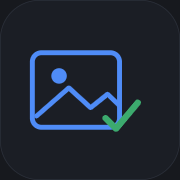
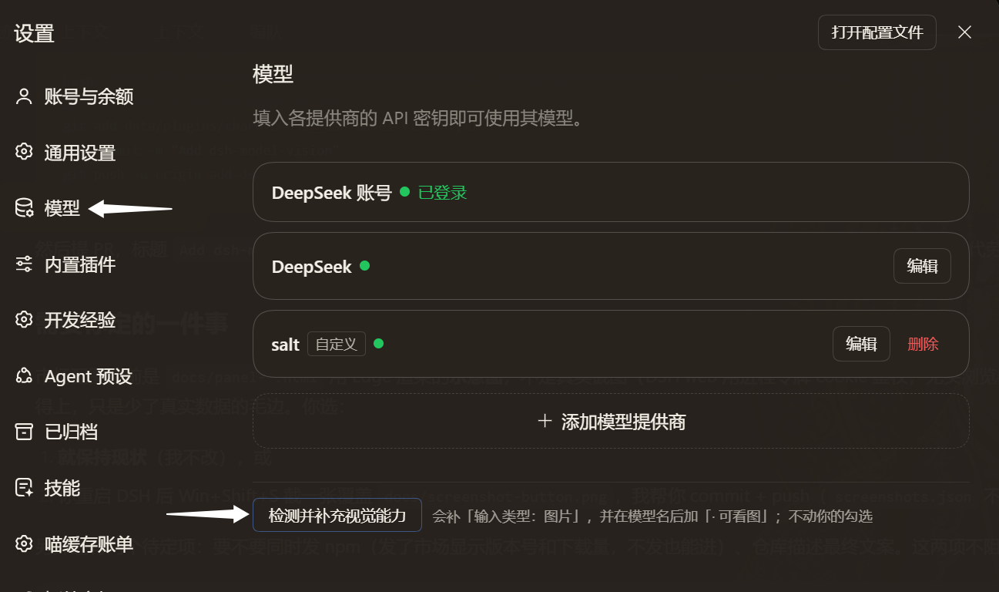

<div align="center">
  

# dsh-model-vision

**让 DSH 自动认出哪些模型能看图。**

能看图的模型自动勾上「输入类型：图片」，名字后面标出「· 可看图」——不用再手动一个个点，
也不会下次点「获取可用模型」就被清掉。

[](LICENSE)
[](https://nodejs.org)
[](https://github.com/awesome-dsh-plugin/awesome-dsh-plugin)
[](https://github.com/charovo0059/dsh-model-vision/stargazers)

</div>



---

## 你可能正遇到这些

- 贴了一张图，DSH 回「这个模型不支持图片输入」，或者图干脆被当没看见
- 网关的说明里明明写着某个模型支持图片，DSH 里它却没有「图片」这个选项
- 你手动勾过一次「图片」，下次再点「获取可用模型」，勾又被清掉了

**原因**：DSH 拉模型清单时只记下了名字、上下文长度和输出上限，**漏记了「能不能看图」**。
于是每个拉回来的模型都按默认值当成只能读文字，带图请求在附件阶段就被拒了。

这个插件把这一项补上。

> **适合**：你用第三方网关 / 中转站 / 自建服务（任何 OpenAI 兼容地址），并且想让模型能看图。
> **不适合**：模型本身就不吃图片。插件不会让只读文字的模型学会看图。

---

## 安装

装完都要**重启 DSH**。

### 从插件市场装（推荐）

**设置 → 插件 → 插件市场** → 搜索 `dsh-model-vision` → 安装。

> 还没上架时（或搜不到）用下面两种方式。

### 从 GitHub 装

```bash
dsh plugin --profile web add github:charovo0059/dsh-model-vision
```

这条命令会同时把插件登记进 `dsh.profile.bundles`，不用手改配置。
如果你用的不是默认 profile，把 `web` 换成你的 profile 名。

### 从本地目录装（自己改代码时）

```bash
git clone https://github.com/charovo0059/dsh-model-vision.git
dsh plugin --profile web add link:<刚克隆下来的目录绝对路径>
```

### 装完自检

不确定哪一步缺了，跑这个（会逐项告诉你）：

```bash
node tools/check.mjs --profile web
```

### 想先看看它会改什么，再决定装不装

```bash
node tools/preview.mjs --profile web
```

只读：读你的配置、问一次网关、把「会改哪几行」打出来，**一个字节都不写**，DSH 开着也能安全跑。

---

## 怎么用

**装好就在后台干活，你什么都不用点。**

它会在三个时机自动对账：

| 时机 | 做什么 |
|---|---|
| DSH 启动后 3 秒 | 把已经配好的模型扫一遍，该勾的勾上 |
| 每次你点「获取可用模型」 | 5 秒内补齐新拉进来的模型 |
| 每 5 分钟 | 对一次账，上游换了能力也能跟上 |

想立刻检查一遍：

> **设置 → 模型** → 滚到模型列表最下面 → 点「检测并补充视觉能力」

点完就地出结果（一句话 + 「展开明细」），不用换页。

### 它判断能力的顺序

1. **先看网关自己怎么写的** —— 写了就照它写，这一步很便宜，不花钱；
2. **网关没写的模型，才真的发图去问** —— 发一张纯色图问「这是什么颜色」，问两轮、两个不同颜色，都答对了才算能看图。

几个你会关心的事：

| 你可能会问 | 答案 |
|---|---|
| 会动我的勾选吗？ | 不会。只补「输入类型：图片」，模型还是你选的那些 |
| 会花很多额度吗？ | 只测网关没写能力的模型，每个最多两次很小的请求（64×64 纯色图）；单次最多 40 个，超出显示「跳过 N 个」 |
| 会重复测吗？ | 不会。结论会记住：能看图的记 7 天，不能的记 1 天 |
| 为什么有的模型「没结论」？ | 模型答非所问（比如回一整段话不提颜色）。这种**不会**被当成"只能读文字"，宁可不写也不写错 |

---

## 支持哪些网关

只要能被 DSH 当供应商用，基本都能处理——它不假设路径和字段名。

| 你的服务 | 怎么找模型清单 | 能不能一键探测 |
|---|---|---|
| 官方 / 中转站（OpenAI 兼容） | `/models`，找不到就试 `/v1/models`、`/model/info` | ✅ |
| 自建 vLLM / LM Studio / one-api / new-api | 同上（`baseURL` 写不写 `/v1` 都行） | ✅ |
| Anthropic 协议（`/v1/messages`） | `/v1/models?limit=1000` | ✅ |
| Ollama | `/api/tags`（按模型名匹配） | ✅（要它自己答对才算） |
| Responses 协议（`/responses`） | `/models` | 只看清单，不探测（它的图片格式不一样，乱猜会误判） |

判断能力时它认这些写法：

- **模态列表**：`input` → `input_modalities` → `inputModalities` → `architecture.input_modalities` → `modalities.input`
- **布尔标记**：`vision` → `supports_vision` → `image_input` → `capabilities.vision`

第一个真正表态的胜出。**全程沉默 = 没结论**，不猜。

---

## 怎么确认它在工作

**最直观的**：设置 → 模型 → 找一个你确定能看图的模型 → 点开「输入类型」→「图片」已经勾上了。

**看记账本**：每次干完活它都会写一份记录到 `~/.dsh/model-vision.status.json`。
**只看 `message` 这一行就够了**，那是给你写的人话：

```json
{
  "message": "扫了 58 个模型（网关报了 191 个），补了 34 个的「输入类型：图片」"
}
```

一共只会出现这几种话：

| `message` 说什么 | 意思 |
|---|---|
| 补了 N 个的「输入类型：图片」 | 正常干活，补了 N 个 |
| 没有要改的 | 正常，你配的模型都已经对上了 |
| 本来可以补 N 个……但只看不写模式（dryRun）开着 | 你把 `dryRun` 打开了，它只看不动 |
| 出错了：…… | 后面跟的就是原因 |
| 没有可检查的模型 | 还没配供应商，或者没点过「获取可用模型」 |

想追细节再看这几个字段：

| 字段 | 大白话 |
|---|---|
| `wrote` | 这次有没有真的改东西 |
| `routes[].changes` | 改了哪几个模型 |
| `routes[].listed` | 网关报了几个模型（0 = 网关没连上或没公布） |
| `routes[].credential` | 用的哪份 key（`file` = 本地凭据文件，`absent` = 没找到） |
| `error` | 出了什么错（没有就是 `null`） |

---

## 会不会弄坏我的配置

- **只写「输入类型」这一个字段**，写完立刻停手
- 没有要改的 → **一个字节都不落盘**
- 写之前逐行比对，注释、字段顺序、`!!js` 表达式原样保留
- 万一写坏了：改之前先备份 `~/.dsh/profiles/web/cordis.patch.yml`，出问题直接覆盖回去
- 想让它只看不写：配置里加 `dryRun: true`，它照样记账，但不动你的文件

### 它碰什么、不碰什么

| 它要 | 用来做什么 |
|---|---|
| 读你的配置文件 | 看每个模型现在声明的「输入类型」 |
| 写你的配置文件 | 只写 `input`（文字/图片）和模型名末尾的「· 可看图」 |
| 读本机凭据（`~/.dsh/.credentials.yaml` 的 `refs`） | 访问你自己填的那个 API 地址时要带 key |
| 访问你填的那个 API 地址 | 读模型清单；探测时发两张 64×64 纯色图 |

**不连任何第三方服务器**，不上传对话内容，不读你的会话记录，没有遥测。

### 它不做什么

- 不会让只读文字的模型学会看图
- 不会替你填 API key
- 不会改模型名字（除了末尾那个标注）、上下文长度、价格
- 不会因为网关没说就自己猜一个能力
- 不会动你没让它管的那些供应商

---

## 出问题怎么办

| 现象 | 先看哪 | 常见原因 |
|---|---|---|
| 某个模型没被勾上 | 状态记录里的 `held` | ① 你自己勾过"只要文字"，插件尊重你的选择 ② 网关没说明它支持图片 ③ 它确实只能读文字 |
| 一个都没勾上 | 状态的 `listed` 是不是 0 | 网关地址填错、服务没开，或者网关压根不公布模型清单 |
| 报 `401` | 状态的 `credential` | 没找到这家的 key。把 key 填进「模型」设置页，或确认网关不需要 key |
| 勾上了，贴图还是失败 | — | 网关说支持但实际不支持。把那个模型的「图片」取消掉，或去网关那边确认 |
| 模型名太长 / 不想看标注 | — | 配置里 `badgeSuffix: ''`，重启后标注会自己撤掉（它只摘自己加在末尾的那一段） |
| 改了 5 分钟才生效 | 状态的时间 | 正常节奏就是这样；想立刻生效就重启 DSH |
| 点了按钮报「超出上限跳过 N 个」 | 结果里的这行字 | 单次探测有上限（默认 40 个）。再点一次会接着测（已测过的不会重来），或把 `maxProbes` 调大 |
| 探测显示「没结论」 | 结果的这一行 | 模型没正面回答颜色。不会被误标成"只能读文字"，你手动勾一下即可 |
| 按钮不见了 | 设置 → 模型，列表最下面 | 先重启 DSH。如果某个 DSH 版本改了这个位置，插件会自动退成「设置 → 视觉能力」单页，功能相同 |
| 按钮说「后台服务没响应」 | — | 宿主半边没挂上，重启一次 DSH |

---

## 卸载

```bash
dsh plugin --profile web remove dsh-model-vision
```

再把 `~/.dsh/profiles/web/package.json` 里 `dsh.profile.bundles` 的 `"dsh-model-vision"` 删掉，重启 DSH。

已经勾上的「图片」会留着——那已经是你配置里正式的一项了，插件不负责回滚。想取消就手动去设置页把「图片」取消勾选。

---

## 配置（一般不用改）

装好即用。要调的话，在 `~/.dsh/profiles/web/cordis.patch.yml` 里加一段覆盖。
**`name` 那一行必须逐字写成 `dsh-model-vision`**，否则会被静默跳过：

```yaml
- id: model-vision
  name: dsh-model-vision
  config:
    mode: fill               # fill = 只补空缺（默认）；sync = 连你手写错的也按网关纠正
    routes: []               # [] = 所有供应商；也可以只写某几个的名字
    dryRun: false            # true = 只看不写，专门用来观察
    intervalMs: 300000       # 每 5 分钟对一次账
    watchMs: 5000            # 每 5 秒看一眼配置有没有变
    badgeSuffix: ' · 可看图'  # 名字后面的标注；'' = 不加
    probe: false             # true = 后台也主动发图探测（默认只在点按钮时探测）
    probeRounds: 2           # 每个模型问几个颜色
    maxProbes: 40            # 单次最多测几个模型
    timeoutMs: 15000         # 读模型清单的超时
    probeTimeoutMs: 30000    # 单次探测的超时
    statusFile: ''           # '' = 默认位置；false = 不写
```

---

## 名词小抄

| 你会看到的词 | 意思 |
|---|---|
| 网关 / 中转站 | 你在「模型」设置里填「API 地址」的那个服务 |
| 「获取可用模型」 | 设置 → 模型 里的按钮，点一下把网关的模型清单拉进来勾选 |
| 「输入类型」 | 每个模型下面能勾「文字 / 图片」的那一组选项 |
| 「能看图」的模型 | 支持图片输入的模型（多模态） |
| 状态文件 | `~/.dsh/model-vision.status.json`，它每次干活的记账本 |

---

<details>
<summary><b>技术细节（给想深挖的人）</b></summary>

### 为什么 DSH 会漏记这一项

DSH 的「获取可用模型」读的是 `@deepseek-ai/dsh-llm-pi-ai` 里的 `readListing()`，它每条只保留四个字段：

```js
id / name / contextWindow / maxTokens
```

`input`、`input_modalities`、`architecture.input_modalities`、`vision` —— 一个都不解析。
于是每个模型走 `entry.input → 内置目录 → defaultInput`，而 `DEFAULT_INPUT = ["text"]`，带图请求在附件阶段就被拒：

```
LlmError: pi-ai model "<id>" does not support image input
(category: UNSUPPORTED_CONTENT)
```

本插件读网关自己公布的能力，把 `input: [text, image]` 写回 `llm-pi-ai` 的模型条目。

### 为什么标注写进名字，而不是画个小标签

`conversation.input.model.label` 是 **single 插槽**，已经被 `dsh-client-ui-deepseek-model-label-1017` 占了；
而 `ModelCatalogModel` 只有 `{ id, name, description, reasoning }`，没有能力字段。
写进名字是唯一在所有地方都看得见的做法——切模型、设置页、会话头部都生效。

### 三种触发

- `start` —— 加载后 3 秒
- `config-change` —— 每 5 秒比对一次组合配置的指纹，变了才请求网关
- `interval` —— 每 5 分钟兜底

> `config-change` 是指纹轮询而不是文件监听：profile 补丁路径的监听属于 Loader（`hmr.watchConfig` 拒绝第二次注册），插件插不进去。
> 轮询只读组合后的配置、不打网络。写完一次后立刻采纳新指纹，避免自己的写入回声成第二次空 sweep。

### 两条写通道

优先 `ctx.configEditor.edit()`（带文件锁、schema 校验、Loader 重组）；
热重载时报 `HMR transactions cannot be nested` 时，回落到按行改 `cordis.patch.yml`（临时文件 + rename，保 CRLF、保注释、绝不写重复的 `input` 键）。

### 凭据解析

`credentials` 服务 → 环境变量（`apiKeyEnv`）→ `~/.dsh/.credentials.yaml` 的 `refs`。
实际用了哪条会记进状态记录的 `credential`，401 时先看它。

### 一键按钮的接口

`POST /plugins/model-vision/detect`（仅本机、需 `x-model-vision` 头、只接受 POST）。

- body `{}` → 探测并补充
- `{"dryRun":true}` → 只看不写
- `{"route":"salt"}` → 只测一家

返回 `{ ok, message, routes: [{ changes, held, probedModels, error }] }`，设置页只渲染这个。

### 跑测试

```bash
npm test

node test/vision.test.mjs     # 30 个：解析、决策、按行改文件、CRLF、幂等、人话摘要
node test/wiring.test.mjs     #  9 个：两条写通道、dryRun、凭据、轮询
node test/probe.test.mjs      # 12 个：图片字节、请求形状、四种判定（能看/不能看/没结论/故障）
node test/oneclick.test.mjs   #  9 个：多路径清单、Ollama 形状、一键端点、缓存与上限
node test/contract.test.mjs   #  7 个：前端与后端对同一批外部名字的约定
```

一共 67 个，全部零依赖、不联网（探测测试用本地假网关）。

### 跨版本维护（DSH 升级后看这一节）

这个插件只依赖四个外部名字，全部集中写在两处：

| 名字 | 宿主 `lib/index.js` | 浏览器 `lib/client.js` |
|---|---|---|
| 请求路径 | `RPC_PATH` | `CONTRACT.rpcPath` |
| 请求头 | `RPC_HEADER` | `CONTRACT.rpcHeader` |
| 协议版本 | `PROTOCOL_VERSION` | `CONTRACT.protocol` |
| 挂载插槽 | — | `CONTRACT.slot`（模型页底部） |

`node test/contract.test.mjs` 会逐项比对两边。任何一边改了名字而另一边没跟上，这个测试立刻失败——不会等到用户点按钮时才发现。

**DSH 升级后只要两步：**

1. 跑 `node test/contract.test.mjs`。全绿 = 接口没变，什么都不用改。
2. 如果红了，看它报哪个名字，改 `CONTRACT` 或宿主导出里那一行即可。

已经内置的两条自愈：

- **插槽被改名 / 移除**：模型页底部那个位置 4 秒内没注册成功，就自动退成「设置 → 视觉能力」单页，用同一个组件渲染，功能一样。
- **后台没挂上**：按钮会直接说「后台服务没响应，重启一次 DSH 再试」，不会静默失败。

</details>

---

## 参与

- 发现 bug 或想加功能 → [开 issue](https://github.com/charovo0059/dsh-model-vision/issues)
- 提 PR → 先看 [CONTRIBUTING.md](CONTRIBUTING.md)，改完跑 `npm test`
- 换了新网关 / 新写法它能认但没认出来 → 带着网关的 `/models` 返回片段开 issue，那是最有用的反馈

## 许可证

[MIT](LICENSE)
